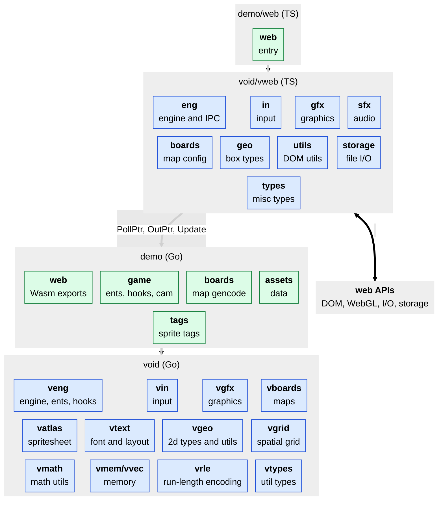

# void

void is a 2D game and app engine for web browsers featuring:
- all game code in Go Wasm.
- fast loading.
- few dependencies.
- selective update for lo energy idle.
- compilation to a single standalone HTML file.
- text, nine-patch, and button primitives for basic UI.

## Development

all system packages start with "v" such as `vents` for "void ents".

see the [agent file](AGENTS.md).

### Project Layout

- `src/void/`: game engine.
- `src/void/vweb/`: web platform.
- `src/cmd/`: command line utils for building void apps.
- `src/internal/demo/`: engine demonstration.

### Architecture



### Levels and Boards

levels are a higher-level app composition that selects a board and wires gameplay around it.

### Ents and Hooks

ents are a single data and behavior instance. hooks compose ents
with engine state and register as update functions.

ents with an update hook return whether they have been updated and so request a new frame. this is important for lo energy apps.

see the [agent skill](.agents/skills/add-ent/SKILL.md).

### Native Dependencies

- Aseprite
- cwebp
- Go
- Mono
- Node.js
- Shader Minifier
- TinyGo
- wasm-opt
- watchexec

### Make

debug make with `V=1 make --jobs=1`.

make debug builds with `DEBUG=1 make`.

### Testing

an example of a playwright test that takes a screenshot and verifies no console logs:

```ts
import {expect, test} from '@playwright/test'

const logs: string[] = []

test.beforeEach(async ({page}) => {
  logs.length = 0
  await page.addInitScript(() => {
    addEventListener('error', ev =>
      console.error(
        `[window.error] ${ev.error instanceof Error ? ev.error.message : ev.error}`
      )
    )
    addEventListener('unhandledrejection', ev =>
      console.error(
        `[window.unhandledrejection] ${ev.reason instanceof Error ? ev.reason.message : ev.reason}`
      )
    )
  })
  page.on('console', onConsole)
  page.on('pageerror', onPageError)
})

test.afterEach(async ({page}) => {
  page.off('console', onConsole)
  page.off('pageerror', onPageError)
  expect(logs, logs.join('\n')).toStrictEqual([])
})

test('test', async ({page}) => {
  await page.goto('http://localhost:1234/')
  await page.locator('canvas').click({position: {x: 123, y: 456}})
  await expect(page.locator('canvas')).toBeVisible()
  await expect(page).toHaveScreenshot('load.png', {maxDiffPixelRatio: 0.01})
})

function onConsole(msg: {type(): string; text(): string}) {
  if (msg.type() === 'debug') return
  logs.push(`[console.${msg.type()}] ${msg.text()}`)
}

function onPageError(err: unknown) {
  logs.push(
    `[pageerror] ${String(err instanceof Error ? err.stack || err.message : err)}`
  )
}
```

## Copyright and License

© oidoid.

### AGPL-3.0-only

This program is free software: you can redistribute it and/or modify it under
the terms of the GNU Affero General Public License as published by the Free
Software Foundation, either version 3 of the License, or (at your option) any
later version.

This program is distributed in the hope that it will be useful, but WITHOUT ANY
WARRANTY; without even the implied warranty of MERCHANTABILITY or FITNESS FOR A
PARTICULAR PURPOSE. See the GNU Affero General Public License for more details.

You should have received a copy of the GNU Affero General Public License along
with this program. If not, see <https://www.gnu.org/licenses/>.

```
╭>°╮┬┌─╮╭─╮┬┌─╮
╰──╯┴└─╯╰─╯┴└─╯
```
